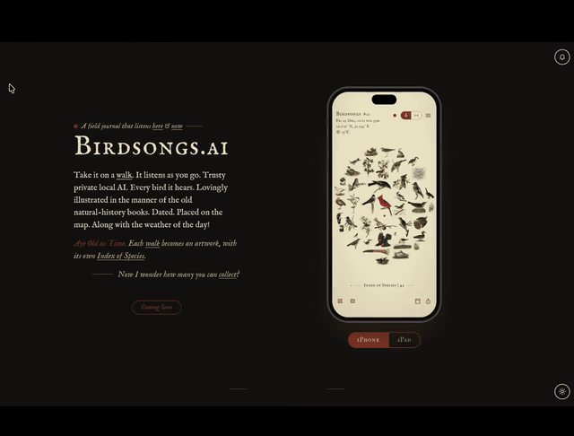

# Birdsong app (test build)

[](docs/media/Coming_soon_compressed.mp4?raw=true)

Birdsong for iPhone, iPad, Mac and Android. The plate is
[Birdsong](https://github.com/dopeytree/birdsong)'s own `index.html`, shown in
a native web view and fed by a small web server inside the app. That server
does what nginx does in the Docker image, in one of two modes:

- **Station:** `/api` is forwarded to your BirdNET-Go, or `/graphql` to a
  public BirdWeather station.
- **Listen here:** the app listens through the microphone, runs BirdNET (and
  friends) on the device, and answers the same BirdNET-Go endpoints from what
  it heard. Recordings and spectrograms included.

This is a **test build**: it can download every model below so they can be
compared side by side, including ones that can't ship in a paid app.

## Set up on a Mac

You need Xcode (installed) and Flutter. The iPhone and iPad app needs iOS 18
or later (iOS 18, 26 and 27).

```sh
brew install --cask flutter      # if `flutter` isn't installed yet
cd ~/birdsong-app
./tool/bootstrap.sh              # makes the iOS/macOS/Android projects, once
```

### Run it on the Mac

```sh
flutter run -d macos
```

### Run it on your iPhone

1. Plug the iPhone in, unlock it, and trust the Mac.
2. On the iPhone: Settings > Privacy & Security > Developer Mode > on (it restarts).
3. `open ios/Runner.xcworkspace`, select **Runner** > **Signing & Capabilities**,
   tick *Automatically manage signing* and choose your Apple ID as the Team
   (Xcode > Settings > Accounts to add it). A free Apple ID works; its builds
   expire after 7 days, so just run again.
4. Back in Terminal: `flutter devices`, then
   `flutter run --release -d <the iPhone's id>`.
   Use `--release` (or `--profile`): debug builds run Dart far slower.
5. First launch on the phone: Settings > General > VPN & Device Management >
   trust your developer certificate, if iOS asks.

### Tests

```sh
flutter test
```

## Using it

0. First launch walks you through it: choose *This device listens* or
   *I have a station*, download a model, switch on Core ML, allow the
   microphone. Settings > *Show the welcome screens again* repeats it.
1. The app is the plate. Top right: a two-part switch, microphone
   (*Listen here & now*) | sensors (a remote station). Left of it, in Listen
   here, the record button starts and stops a session; on a remote station,
   a button goes to the other saved station (with two) or lists them all.
   Right of it the menu (**Settings**), with the view button (a to g) under
   it. Bottom left, the map; bottom right, share and Save to Photos.
2. **Settings**, in sections: where birds come from; *Listening* (live
   scores per model while listening, threshold, how often, Core ML);
   *Models* (download, tick to listen, which one the plate draws);
   *Location filter*; *Data*.
3. On the plate the date line gives the session's time and place; the
   small arrows at either side step between sessions. A creature being
   heard right now glows, its dot breathing out a ring.
4. **The map** (the map button, top right, in *Listen here & now*; not in
   views d and e, which show one bird alone): the
   collage gives way to a map of the walk, drawn like the plate: paper,
   contours, woods and water, quiet roads. A dotted trail runs from Start to
   End (or Now), with a cross where each species was first heard; tap one
   for its card. Title, date, place and the Index of species stay. Sessions
   split at 42 species are joined into one walk. Settings > *Map*: every
   call instead of first heard, and landmarks, heritage and nature sites
   (off by default; see the note there about what they send where). The map
   needs a connection: MapLibre and d3 load from a CDN, tiles from
   OpenFreeMap, heights from the Mapzen terrain tiles on AWS.

Music, podcasts and other apps keep playing while it listens. Settings >
*Listening* > *Microphone* picks the phone's own (the default: full range of
song, and music stays in full quality on Bluetooth headphones; used even with
a wired headset plugged in) or the headphones' (wired: full range, but the
microphone on the cable rubs on clothes; Bluetooth: call quality, 16 to
24 kHz, which misses higher songs and turns the music to call quality too).
On iPhone the app keeps listening with the screen locked (the orange
microphone dot shows), and keeps the map's trail too: a position about every
30 seconds once you've moved 15 m, and one at each detection.

## Models

Downloaded by the app at runtime into its own folder; none are committed.

| Model | Size | Licence | In a paid release? |
| --- | --- | --- | --- |
| BirdNET+ V3.0 Global 10K FP16 (BirdNET Live build) | 67 MB | Apache-2.0 | Yes |
| BirdNET+ V3.0 British Isles FP32 | 121 MB | Apache-2.0 | Yes |
| BirdNET+ V3.0 Global FP32 | 361 MB | Apache-2.0 | Yes |
| BirdNET V3.0 preview 3.1 British Isles FP16 | 70 MB | CC BY-SA 4.0 | Yes, superseded |
| Google Perch v2 British Isles FP32 | 68 MB | Apache-2.0 | Yes |
| Google Perch v2 Global FP32 | 413 MB | Apache-2.0 | Yes |
| BirdNET v2.4 FP32 | 54 MB | CC BY-NC-SA 4.0 | **No: testing only** |
| BirdNET+ Geomodel V3.0.4 (location filter) | 8 MB | Apache-2.0 | Yes |

Sources: the BirdNET+ V3.0 10K model and geomodel come from
[BirdNET Live](https://github.com/birdnet-team/birdnet-live-app) (pinned
commit); the rest from the Hugging Face repositories BirdNET-Go's model
gallery uses (`tphakala/BirdNET-Plus-V3.0`, `tphakala/BirdNET-v3.0-Models`,
`tphakala/Perch-v2-Models`, `tphakala/BirdNET-v2.4`). Confirm each licence
with its authors before a release; "Powered by BirdNET" credit is required
for BirdNET models.

## Where detections are kept

One folder per listening session, in the app's private storage
(`<app data>/sessions/`), in BirdNET Live's field names:

```
sessions/2026-11-18T221904Z_a91e4c/
  session.json        uuid, start and end (UTC), place, settings, models,
                      weather, stop reason, summary; schemaVersion 1
  detections.jsonl    one detection per line: timestamp, scientificName,
                      commonName, confidence, model, top-5 scores, clip,
                      latitude and longitude (where it was heard)
  track.jsonl         the walk's trail, one fix per line: timestamp,
                      latitude, longitude, accuracy (metres)
  audio/<id>.wav      the clip around each detection
  spectrograms/<id>.bmp
```

Files are written whole (to `.pending`, then renamed). The older
`detections/detections.jsonl` and `sessions.jsonl` are moved into folders on
first launch and kept as `*.migrated`. Weather comes from MET Norway's
Locationforecast (CC BY 4.0), with the position rounded to about 10 km; it
can be turned off under Settings > Location filter.

## Testing on the iPhone

`Run on iPhone.command` installs over the Birdsong already on the phone and
keeps its sessions, recordings and models. `Run on iPhone as a copy.command`
installs a separate app, "Birdsong HH:MM", with its own empty data, beside
the others. A free Apple account allows three apps from this Mac on the
phone at once and ten new app IDs a week, so delete old copies when done.

## Keeping the web page in step

The plate is the Birdsong web page itself (dopeytree/birdsong, `html/`),
copied unchanged into `assets/web/`. Everything the app does differently is
added while serving it (`lib/server/local_server.dart`), and listen mode
answers the page's BirdNET-Go calls itself (`lib/server/local_api.dart`).
So the page's styles, images, fonts and features come in with a copy, and
the app's own changes are never redone.

- **Web to app:** double-click `Update web page.command` (or
  `python3 tool/sync_web.py [--ref v0.43 | --from ~/birdsong]`). It copies
  `html/`, records the commit in `assets/web/UPSTREAM.json`, lists what
  changed upstream, and checks `tool/web_contract.json`: every element,
  function and API call the app relies on. `flutter test` checks it too.
  If something broke, fix the hook in the app (or add a proper hook
  upstream), update the contract, then build.
- **App to web:** anything that would help the web page too (the live glow,
  session line, an app mode that hides the server fields) belongs upstream
  as a small named hook, e.g. `window.birdsongLive()`. Once the page has
  it, the injected copy in `local_server.dart` comes out and the contract
  points at the hook. The injection gets smaller over time.
- **Data:** anything new the app records (sessions, places) is served in
  BirdNET-Go's API shape, so the page and a real station stay
  interchangeable.

## How it fits together

```
lib/
  main.dart, app_state.dart   start-up, shared state
  settings.dart               everything in Settings, saved as JSON
  engine/
    model_catalog.dart        the models above: URLs, rates, windows
    model_manager.dart        downloads, what's installed
    listen_engine.dart        mic -> ring buffers -> models -> detections
    resampler.dart            48 kHz -> 32 kHz polyphase filter
    classifier.dart           ONNX Runtime sessions, scores, geomodel
    labels.dart               every label format in use
  server/
    local_server.dart         127.0.0.1 server: page, source.json, /api
    local_api.dart            the 8 BirdNET-Go endpoints, from local data,
                              and /app/walk.json for the map
  store/
    detection_store.dart      detections (JSON lines) and clips
    media.dart                WAV, FFT, spectrogram BMP
  ui/                         Plate, Listen, Models, Settings
assets/web/                   Birdsong's index.html and fonts (v0.42)
assets/app/                   the app's additions to it: plate-extras.js
                              (folding index, pinch zoom), map-mode.js (map)
tool/bootstrap.sh             one-time set-up
tool/patch_platforms.py       plist, entitlements, deployment targets
```

The page is a copy of `html/index.html` from the `birdsong` repo. The
Fugleramme artwork isn't bundled yet: the page falls back to fetching it from
GitHub, as it does without a local copy.

## Licence

Code: MIT. Bird cut-outs: Fugleramme, CC BY-SA 4.0. Typeface: IM Fell
English, SIL OFL (`assets/web/fonts/OFL.txt`). Models: see the table above.
